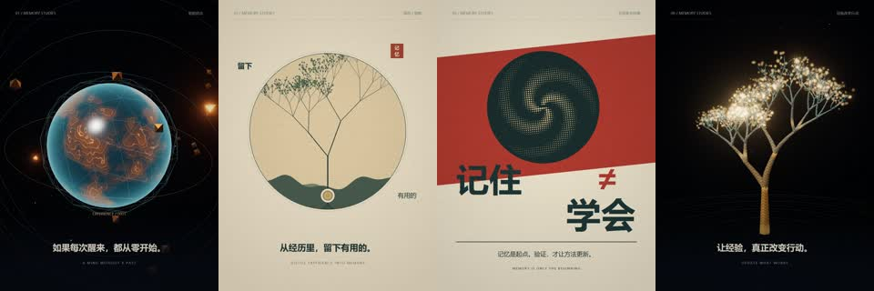
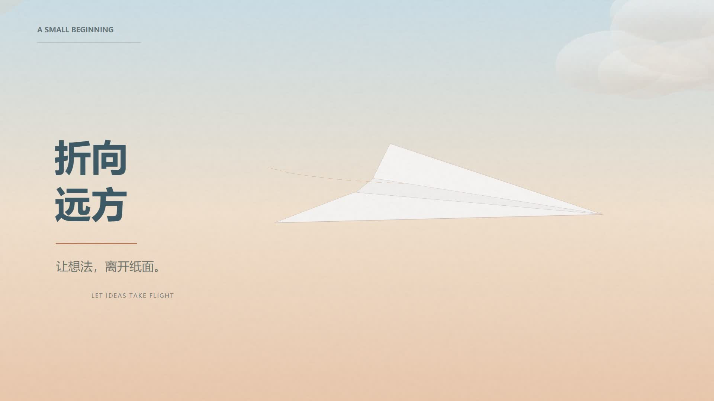
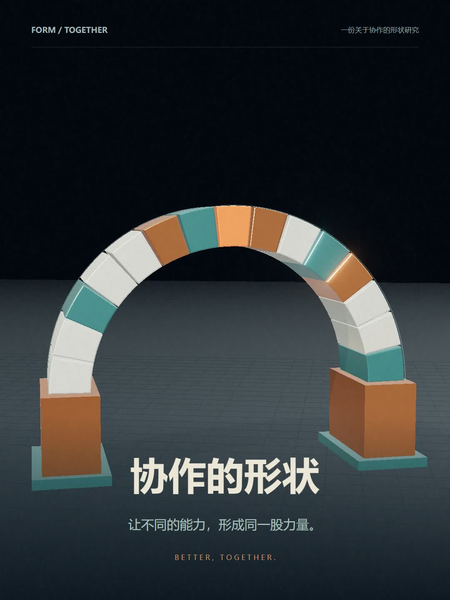

# Code to Video

**给 Agent 一个主题和参考，让它交付视频，不只给提示词。**

Code to Video 是面向编程型 AI 助手的开源 Skill：把参考拆解、分镜、二维/三维动画、声音、渲染和返修串成一条制作流程，交付 **MP4 与可修改源工程**。你可以指出“第几秒、哪里不对”，继续修改同一份工程，而不是每次重新生成一个不可控结果。

它不是视频生成模型，也不是固定视频模板。模型负责编写动画，浏览器绘制画面，FFmpeg 合成视频；结果质量仍依赖模型的创作、实现和审片能力。

## 安装与开始

从 [v0.2.0 Release](https://github.com/Ww-Cooooo/code-to-video/releases/tag/v0.2.0) 下载 **code-to-video-v0.2.0.zip** 并解压。该附件已使用正确的 `code-to-video/` 顶层目录；GitHub 自动生成的 Source code ZIP 顶层名称不同，使用时需重命名。

把整个 Skill 文件夹命名为 `code-to-video`，放入以下任一位置：

- Claude Code 个人技能：`~/.claude/skills/code-to-video/`
- 当前项目技能：`.claude/skills/code-to-video/`

其中应直接包含 `SKILL.md`，不要多嵌套一层。若已有同名目录，先比较版本，不直接覆盖。其他支持 SKILL.md 的宿主可使用其技能目录；本项目未逐一验证这些宿主。安装规则见 [Claude Code 官方文档](https://code.claude.com/docs/en/skills)。

安装后，在 Claude Code 输入：

```text
/code-to-video 做一条关于 Agent 记忆与自我进化的 30 秒短片。
面向普通观众。先确定视觉方向，再制作 MP4，并保留源工程。
```

也可以提供参考视频、自己的截图、文案和音乐。首次使用时让 Agent 运行环境检查；**复制 Skill 不会自动安装依赖**。

在 Skill 目录内：

```bash
python scripts/video.py doctor
```

默认运行链需要 Python 3.10+、Playwright、Chrome/Edge/Chromium、FFmpeg/FFprobe；接触表需要 Pillow。纯二维工程不需要 Node.js，三维示例另需 Node.js 与 Three.js。检查出缺项后再按 [运行说明](references/runtime.md) 安装，不需要购买视频模型服务。

## 它怎样帮助制作

| 你需要的结果 | Skill 的做法 |
| --- | --- |
| 参考好作品，但不照搬 | 区分实际观察与推测，把构图、主体关系、材质和节奏迁移到新主题 |
| 不只是文字翻页 | 先把含义变成可见动作，再选择二维、三维、截图或其他合适素材 |
| 能针对某一秒修改 | 用绝对时间驱动画面，保留工程和版本，不把录屏当唯一输出 |
| 少漏掉穿模、裁字和突兀转场 | 检查代表帧，关键变化加密采样，明确区分技术检测与实际审片 |
| 换主题、尺寸和片长 | 独立项目配置控制输出规格；构图由 Agent 重新设计，不强行缩放旧模板 |
| 不依赖作者电脑 | 不含个人路径、私有 Skill 或浏览器登录态，工具按 PATH 或环境变量查找 |

默认脚本在独立无头浏览器中工作，不连接日常浏览器，也不调用外部付费模型。渲染页面的外部网络请求被阻止，资源需放进项目。创作时使用的宿主模型可能在云端，因此这不是“整个对话完全离线”的承诺。

## 先跑一个小样

这段只验证工具链，不代表完成主题创作：

```bash
python scripts/video.py init my-film --width 1280 --height 720 --fps 30 --duration 6
python scripts/video.py preview my-film --out review-v1
python scripts/video.py render my-film --out output/film-v1.mp4
python scripts/video.py verify my-film output/film-v1.mp4 --out output/film-v1-check.json
```

这个小样没有音轨，工具会明确提示。正式有声片可在 project.json 配置音频。每次返修用新输出名；工具拒绝覆盖既有工程、成片和检查记录。

接下来由 Agent 按主题改写生成的 `film.mjs`。接口、音轨配置、密集采样、失败恢复与浏览器选择见 [运行说明](references/runtime.md)。

## 四个完整原创示例

四条片子均有中文短句和原创合成配乐，无旁白。**[在 Release 下载全部 MP4](https://github.com/Ww-Cooooo/code-to-video/releases/tag/v0.2.0)**；视频不放入 Git 历史，源码与预览图保留在仓库。

| 示例与运行方法 | 规格 | 画面与叙事 |
| --- | --- | --- |
| [记忆与自我进化](examples/memory-growth/README.md) | 36 秒 · 1080×1440 · 30 fps | 同一迷宫里的两次选择，纸面记忆树、蓝图、海报与三维生长 |
| [噪声之外](examples/signal/README.md) | 20 秒 · 1080×1440 · 30 fps | Canvas 2D 纸面印刷与动态排版，杂乱输入变成连续线索 |
| [折向远方](examples/paper-flight/README.md) | 24 秒 · 1920×1080 · 30 fps | 明亮柔和的三维纸张折成纸飞机，然后起飞 |
| [协作的形状](examples/together-arch/README.md) | 24 秒 · 1080×1440 · 30 fps | 陶质与金属模块从两端装配成拱形，让光点沿完整路径通过 |

### 记忆与自我进化



### 噪声之外


### 折向远方



### 协作的形状



示例保留了真实返修的方法：核先消失再长树；检查纸飞机的地面与画框边界；调整拱形高光与装配位置。它们是四个独立创作案例，不是换标题即可交付的通用模板。纸张变化不是折纸教程，拱形不是结构受力验证，迷宫不是实际 Agent 训练实验。

示例不打包参考片媒体、第三方音乐、字体或 node_modules。音轨通过源码生成，运行方法见各示例 README；中文字体采用系统回退，不同系统可能有排版差异。

## 适合与不适合

适合概念短片、科普动画、产品动效和片头，以及已有代码影片的定点返修。

它不能凭这套脚本直接生成写实真人表演，也不是实拍素材的完整非线性剪辑器。既有 Remotion 或其他制作链可以继续使用，不必迁移。高质量的复杂三维、长片和声音设计可能需要更多制作与审查，不能承诺“一句话一次完成”。

代码检查不能证明审美质量；没有实际观看或听音，就不能声称相应验收通过。查看 [审片与返修](references/review-and-repair.md)。

## 测试与开发

```bash
python -m unittest discover -s tests -v
```

测试覆盖配置校核、时间采样、工程引用边界和已有文件保留。真实渲染验证与触发样例见 [TESTING.md](TESTING.md)。Windows 是本版实测环境；macOS/Linux 路径适配已编写，但尚未在对应系统验证。

目录入口：

- [SKILL.md](SKILL.md)：Agent 的制作指引。
- [scripts/video.py](scripts/video.py)：环境检查、工程初始化、预览、导出和技术核验。
- [视觉方向](references/visual-direction.md)：从主题与参考走向画面。
- [四个原创示例](examples/)：独立动画工程、预览与运行方法。
- [版本记录](CHANGELOG.md)：本地版与公开发行版的变化。

## 许可与安全边界

本项目的文档、脚本和原创示例使用 [MIT 许可证](LICENSE)。第三方库和用户素材遵循各自许可，公开参考链接不等于授权复制。借鉴来源与工具归属见 [SOURCES.md](SOURCES.md)。

Skill 不自动安装依赖、购买服务、读取 Cookie、上传素材或发布作品。调用外部生成服务、使用额外接收方或公开发布前，仍需相应授权。只执行自己创作或已经审查的动画工程，不把不可信网页代码直接当作制作工程运行。
